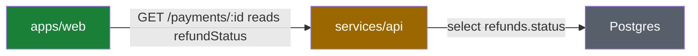

# System recap (visual plan / visual recap)

Produce a high-altitude, visual review aid directly in the PR description. No
deployment, no third-party service: GitHub renders the block (including mermaid
diagrams), and the PR itself is the storage. Follow the format exactly. The
marker-delimited blocks are machine-ingestable.

The author owns the **Breaking change** checkbox. The agent recommends its state
from the recap classification and owns exactly three marker-delimited blocks at
the bottom of the description, in this order: **References**, the **system
recap**, and **Agent context**.
`/pr-handoff` owns and publishes the author's "Why", "Decisions", and "Worth
looking at" sections. Do not edit those sections. The three agent blocks are
informational and non-blocking. They supplement the author's text and normal
code review; they never replace reading the diff.

## Two modes, one format

- **Plan mode** (before/while implementing): describe the intended change
  against the current system. If no PR exists yet, put the block in the plan
  document or message; move it into the PR description once the PR exists.
- **Recap mode** (PR creation and every meaningful update): describe what the
  diff actually does. Replaces a plan-mode block if one exists.

## Source-of-truth rules (non-negotiable)

1. **Recap mode reads the diff, not memory.** Generate the recap from
   `git diff origin/<base>...HEAD` (plus `git diff --stat`) against the fetched
   PR base branch. Session context may explain intent, but every claim about
   what changed must be checkable against the diff.
2. **Components come from the repository layout.** Name each touched component
   by the smallest directory that owns it: an app, package, service, or module
   (for example `apps/dashboard` or `packages/ui`). Use the same name in the
   Impact table and the diagram. Do not invent a taxonomy or commit one.

## Risk classification

Classify each touched component, then roll up to the highest severity as the
overall classification (`breaks` > `adds` > `extends` > `composes`):

| Classification | Meaning                                                    | Risk     |
| -------------- | ---------------------------------------------------------- | -------- |
| `composes`     | Uses existing components as-is; wiring and call sites only | Low      |
| `extends`      | Changes a component's behavior, shape, or contract         | Medium   |
| `adds`         | Introduces a new component                                 | High     |
| `breaks`       | Semantic breaking change to a frozen surface (see below)   | Critical |

### Frozen surfaces

A frozen surface is anything consumed outside this PR's own release: another
repository, a deployed client, a published package, or data already at rest.
That covers published package exports, HTTP routes with their request and
response shapes and status codes, webhook and event payloads, database schemas
and shipped migrations, and URLs or config keys that external parties depend
on. If the repository's `AGENTS.md` or `CLAUDE.md` names frozen surfaces, that
list wins.

Touching a frozen surface's files is a path fact, not a classification.
Implementation and test changes there are routine. Classify a component
`breaks` only when its contract changed: request or response types, routes,
status codes, validation rules, enum values, exported names, or a persisted
shape. Otherwise classify it `composes` or `extends` as usual.

A `breaks` classification recommends checking the **Breaking change** box and
names the broken surface in the agent-owned recap sentence and diagram. The
author's choice controls the checkbox. Where the repository has an artifact
that acknowledges the break (a changeset with the right version bump, a
regenerated client or snapshot, a new migration instead of an edited one), it
lands in the same PR. A `breaks` classification missing an applicable artifact
is a blocker.

Publish the concrete consequence when a rule or contract changes, rather than a
checklist of routine compliance claims. Describe API or persisted-format
changes in Impact or Before and after. Put an actual breaking change or rollout
constraint in a short sentence before the collapsed recap, so reviewers see it
without expanding. Name any required acknowledgment artifact there. A touched
path alone does not need a compatibility note.

## Block formats

Each block sits between its own HTML comment markers (`references`,
`system-recap`, and `agent-context`) and is rewritten **whole** on every run.
Nothing outside the markers belongs to this skill. Emit only blocks with useful
material.

### References (`references`)

Short. Only links carrying something the diff and the repo do not, one line
each saying what the link proves:

- the ticket / Linear issue, and the design doc or spec if one exists;
- external documentation or source that **backs a non-obvious behaviour this
  PR depends on** and that you had to go find, such as a provider's error-code
  table or the SDK source a workaround is derived from;
- a related or prerequisite PR whose context is not in this diff.

Do **not** link files or docs inside this repo: the reviewer has the diff and a
future agent has the tree. Do not link documentation for things any competent
reader already knows (the language, the framework, GitHub markdown), a repo
homepage, a generic console URL, or anything you did not actually consult.
Never invent a ticket URL. When nothing clears that bar, emit no block rather
than padding it; two good links beat six.

Write it for a human. Every entry is a markdown link whose text is what the
thing is actually called (the ticket's title, the document's title, the PR's
title), never a bare URL, a raw id, or "this doc". The clause after it is
plain English saying why a reader would open it, not a path or a keyword.

````markdown
<!-- references:start -->

## References

- [PAY-1234: show the refund status on the payment page](https://linear.app/…)
  — the ticket.
- [Stripe: refund object](https://…) — the status list the new badge maps from.

<!-- references:end -->
````

### System recap (`system-recap`)

Wrap the recap in one `<details>` block, closed by default. Its `<summary>`
names System recap, the overall classification, and risk. In plan mode, use
System plan. Keep these items inside, in order:

1. The short `HEAD` commit in recap mode, followed by one sentence naming the
   changed behavior. Omit the commit in plan mode.
2. An **Impact** table with one row per touched component.
3. A **Before and after** section when the change alters a schema, request,
   state transition, persisted shape, or observable behavior.
4. The legend for a system map, then one mermaid diagram when it helps explain
   the change.

Pick the diagram that explains the change:

- **System map** when the diff crosses components: a PR-scoped change map of
  how the touched components interact _because of this diff_.
- **Change flow** when the diff stays inside one component: a flowchart or
  sequence diagram of the behaviour the diff changes, without the legend and
  colours.
- **No diagram** when the tables explain the change fully, such as a file move
  or a small helper addition. Keep the useful recap text.
- **No block** when the diff changes no runtime, contract, data, developer
  workflow, or operational behavior.

````markdown
<!-- system-recap:start -->

<details>
<summary>System recap · <b>extends</b> · medium risk</summary>

Reviewed head `def5678`.

The payment page now shows the refund status the API returns.

### Impact

| Component | Classification | Impact |
| --- | --- | --- |
| `apps/web` | `composes` | Renders the new status badge. |
| `services/api` | `extends` | Adds `refundStatus` to `GET /payments/:id`. |

### Before and after

| Before | After |
| --- | --- |
| `GET /payments/:id` has no refund field. | `GET /payments/:id` returns optional `refundStatus`. |

**Legend:** green = composes (wiring only) · amber = extended by this PR · red =
new component **or** frozen-surface break · gray = context (unchanged, included
only when an edge crosses it).



</details>

<!-- system-recap:end -->
````

Format rules:

- Use `<details>` without an `open` attribute. Keep classification and risk in
  `<summary>` using HTML, since Markdown does not render inside that tag.
- The **Impact** table names every touched component, gives its
  classification, and states the concrete effect on callers or operators.
  Keep each row to one short sentence. Do not list unchanged context nodes,
  symbol inventories, or routine compliance checks.
- The **Before and after** section uses literal shapes, values, states, or
  behavior. Use a compact table for short comparisons and paired fenced blocks
  when exact JSON or schema text matters. Compare against the PR base, not an
  abandoned implementation from the session. Keep only behavior differences
  that help the reviewer understand the change.
- Keep blank lines after `</summary>`, around fenced blocks, and before
  `</details>` so GitHub renders Markdown and mermaid inside the collapse.
- **System map**:
  - Include only components the diff touches plus neighbors needed to show a
    crossing edge.
  - **Label every edge** with what this PR does across that boundary: route,
    handler, table, state, event, provider endpoint, env var.
  - Color nodes with the four `classDef` styles (`touched` = composes,
    `extended`, `added`, `untouched` for context-only nodes). A `breaks`
    component uses the same red `added` style plus an explicit "(breaks)"
    suffix in its label.
  - Quote node labels that contain spaces or special characters.
- **Change flow** labels every edge or message with the concrete call, state,
  row, or event that moves.

### Agent context (`agent-context`)

One collapsed `<details>` block for facts a future agent cannot recover from the
diff, tests, commits, or author sections:

- external or production evidence and where it came from;
- unverified assumptions;
- non-obvious hazards, dependencies, or rollout constraints;
- failed approaches that left no trace;
- deferred scope with its issue;
- manual verification that CI does not repeat.

Omit summaries, file tours, test recaps, and restated decisions. Use one to five
precise, searchable bullets. Omit the block when nothing clears this bar.

````markdown
<!-- agent-context:start -->

<details>
<summary>Agent context</summary>

- <fact unavailable from the PR, with its source or uncertainty>

</details>

<!-- agent-context:end -->
````

## Workflow

### Before PR creation

`/pr-handoff` supplies existing diff evidence and classification. Acquire only
missing evidence, then render References, the recap, and useful Agent context
into local block files. Return the block contents to the caller. Do not create
the PR or make separate block-update calls. The caller includes all emitted
blocks in the initial body.

### Existing PR recap update

1. Resolve base/head (`gh pr view <n> --json baseRefName,headRefName`), then
   fetch the base branch.
2. List the changed paths with `git diff --name-only origin/<baseRefName>...HEAD`
   and group them into components.
3. Read the full diff for anything you did not author this session. Resolve
   every component classification, frozen surface, and before-and-after
   comparison.
4. Read the short commit for the classified `HEAD` with
   `git rev-parse --short HEAD`, then author useful References, the recap, and
   Agent context following the formats above.
5. Upsert each emitted block with the script next to this file:

   ```bash
   node <this skill's directory>/scripts/upsert-pr-block.mjs <pr-number> <block-file>
   ```

   The script preserves author text, keeps References before the recap and Agent
   context, and refuses duplicated or dangling markers.
6. Repeat after significant new commits. Each emitted block is regenerated
   whole.

### Plan mode

Plan mode emits only the recap block. References and Agent context describe a
landed diff and are written at PR time. The Impact table describes intended
changes, and Before and after describes anticipated contract or behavior
changes. Add a one-line note when the plan changes no component's behavior. If
the plan expects to touch a frozen surface, say whether a `breaks`
acknowledgment is anticipated. Recap mode replaces the plan block once the PR
exists.
